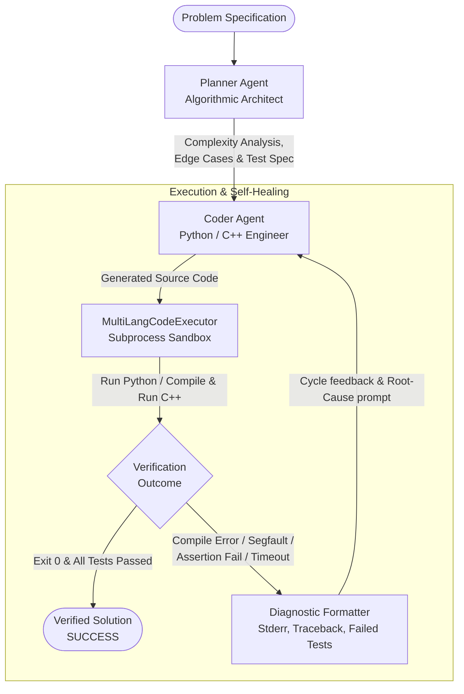

# AutoGen Multi-Agent DSA Solver: Self-Healing Execution Loop for Python & C++

A production-grade, runnable multi-agent system built with **Microsoft AutoGen** that autonomously solves Data Structures and Algorithms (DSA) problems in **Python 3** and **modern C++ (C++17)** with a closed-loop **self-healing execution engine**.

---

## 🌟 Key Features

- **Architectural Separation of Concerns**:
  - **Planner Agent (`Planner`)**: Performs rigorous algorithmic decomposition, proves optimal asymptotic complexity ($O(N)$ vs $O(N^2)$), constructs edge case matrices, and defines comprehensive test case specifications.
  - **Coder Agent (`Coder`)**: Translates algorithmic blueprints into clean, idiomatic Python or modern C++17 source code embedding automated test harnesses with explicit pass/fail assertions.
  - **Multi-Language Executor (`MultiLangCodeExecutor`)**: Implements Microsoft AutoGen's native `CodeExecutor` abstract base class (`autogen_core.code_executor.CodeExecutor`), isolating execution with subprocess timeouts, stdout/stderr capture, and compiler diagnostic extraction.
- **Closed-Loop Self-Healing**:
  - Automatically intercepts **compilation errors** (missing headers, syntax issues, type mismatches), **runtime crashes** (segmentation faults, `std::out_of_range`, `std::bad_alloc`, exceptions), **assertion failures**, and **timeouts** (TLE).
  - Formats structured diagnostic feedback and routes it back to the Coder agent to perform root-cause analysis, generate patches, and re-execute until `ALL TESTS PASSED` or the retry budget is exhausted.
- **Native AutoGen 0.4+ Architecture**:
  - Built on AutoGen's modern asynchronous architecture (`autogen-agentchat` and `autogen-core`).
  - Supports both structured orchestration pipelines (`SelfHealingOrchestrator`) and multi-agent group chats (`RoundRobinGroupChat` with `TextMentionTermination`).
- **Deterministic Mock / Offline Mode**:
  - Includes `create_mock_client()` powered by `ReplayChatCompletionClient` to demonstrate the complete multi-round self-healing cycle (Planner $\to$ Buggy Code $\to$ Error Diagnostics $\to$ Fixed Code $\to$ Verification) without requiring an API key or incurring LLM costs.
- **Cross-Platform C++ Support**:
  - Auto-discovers `g++`, `clang++`, or MSVC (`cl`) across Linux, macOS, and Windows (including MSYS2/MinGW), compiling with `-std=c++17 -O2 -Wall`.

---

## 🏗️ Architecture



---

## 📁 Repository Structure

```
multi-agent/
│
├── .env.example                       # Environment variables template (API keys, models, compiler)
├── .gitignore                         # Build artifacts, caches, and binaries ignore rules
├── pyproject.toml                     # Package configuration, dependencies, and pytest settings
├── requirements.txt                   # Direct dependencies
├── README.md                          # Full documentation and guide
├── main.py                            # Interactive CLI entrypoint
│
├── dsa_autogen/                       # Core Package
│   ├── __init__.py                    # Package exports and version
│   ├── config.py                      # Settings management (Pydantic Settings)
│   ├── models.py                      # Data models (DSAProblem, ExecutionResult, SelfHealingReport)
│   │
│   ├── agents/                        # AutoGen Agents
│   │   ├── __init__.py
│   │   ├── planner.py                 # Algorithmic Planner AssistantAgent
│   │   ├── coder.py                   # Python/C++ Coder AssistantAgent
│   │   └── prompts.py                 # System prompts and diagnostic feedback templates
│   │
│   ├── execution/                     # Multi-Language Execution Subsystem
│   │   ├── __init__.py
│   │   ├── compiler.py                # C++ discovery (g++, clang++, cl) and compilation
│   │   ├── runner_python.py           # Isolated Python runner with timeout & error parsing
│   │   ├── runner_cpp.py              # C++ compilation + native binary execution runner
│   │   ├── autogen_executor.py        # Implementation of AutoGen CodeExecutor ABC
│   │   └── sanitizer.py               # Markdown code extractor and test output parser
│   │
│   ├── orchestration/                 # Workflow & Loop Controllers
│   │   ├── __init__.py
│   │   ├── loop.py                    # Structured SelfHealingOrchestrator state machine
│   │   └── group_chat.py              # AutoGen RoundRobinGroupChat team integration
│   │
│   ├── mocks/                         # Deterministic Mock & Replay Utilities
│   │   ├── __init__.py
│   │   └── mock_client.py             # ReplayChatCompletionClient simulating self-healing
│   │
│   └── problems/                      # DSA Benchmark Catalog
│       ├── __init__.py
│       ├── base.py                    # Problem & TestCase schema
│       └── library.py                 # Two Sum, Trapping Rain Water, Longest Substring, etc.
│
└── tests/                             # Full Automated Pytest Suite
    ├── __init__.py
    ├── conftest.py                    # Pytest fixtures and runners
    ├── test_models.py                 # Data model tests
    ├── test_compiler.py               # Compiler discovery and compilation tests
    ├── test_executors.py              # Python and C++ runner tests (success, fail, timeout)
    ├── test_autogen_executor.py       # AutoGen CodeExecutor interface tests
    ├── test_agents.py                 # Agent factory and system message tests
    ├── test_problems.py               # Benchmark catalog integrity tests
    └── test_self_healing_mock.py      # End-to-end self-healing integration tests
```

---

## 🚀 Installation & Prerequisites

### 1. Python Environment
Python 3.10+ is required:
```bash
python -m venv venv
# On Windows:
venv\Scripts\activate
# On Linux/macOS:
source venv/bin/activate

pip install -r requirements.txt
```

### 2. C++ Compiler Setup
The system requires a C++17 compatible compiler:
- **Linux**: `sudo apt install g++ build-essential`
- **macOS**: `xcode-select --install`
- **Windows**: Install **MSYS2 MinGW-w64** (`pacman -S mingw-w64-x86_64-gcc`) or **MSVC Build Tools**.
  * The compiler engine automatically discovers `g++`, `clang++`, or `cl` in your `PATH` or at `C:\msys64\mingw64\bin\g++.exe`.

### 3. Environment Configuration
Copy the `.env.example` file:
```bash
cp .env.example .env
```
Set your `OPENAI_API_KEY` in `.env` (or set `OPENAI_BASE_URL` to point to Ollama, Groq, DeepSeek, or Gemini).
> **Note**: An API key is **not required** to run tests or explore with the `--mock` flag.

---

## 💻 CLI Usage & Quickstart

### 1. List Available Benchmark Problems
```bash
python main.py --list-problems
```
Output:
```
Available DSA Benchmark Problems:
  * two_sum                   - Two Sum (Target: O(N), O(N))
  * trapping_rain_water       - Trapping Rain Water (Target: O(N), O(1))
  * longest_substring         - Longest Substring Without Repeating Characters (Target: O(N), O(min(N, M)))
  * subarray_sum_k            - Subarray Sum Equals K (Target: O(N), O(N))
```

### 2. Run Self-Healing in Deterministic Mock Mode (Zero Cost, No API Key)

#### Python 3 Self-Healing Run:
```bash
python main.py --problem two_sum --language python --mock
```
*Flow*:
1. **Planner** creates optimal $O(N)$ hash map strategy and edge cases.
2. **Coder** produces initial implementation with an injected edge-case bug (skipping negative numbers).
3. **Executor** runs the Python script; Test 3 fails with an `AssertionError`.
4. **Self-Healing** routes diagnostic trace and assertion failure back to Coder.
5. **Coder** fixes the logic.
6. **Executor** runs the patched code; all tests pass!

#### C++17 Self-Healing Run:
```bash
python main.py --problem two_sum --language cpp --mock
```
*Flow*:
1. **Planner** creates optimal algorithm plan.
2. **Coder** outputs C++ code with a missing semicolon syntax error.
3. **Compiler** fails with `COMPILE_ERROR` from `g++`.
4. **Self-Healing** feeds the compiler diagnostic back to Coder.
5. **Coder** supplies the corrected modern C++17 solution with `#include <unordered_map>`.
6. **Compiler** succeeds, binary executes, and prints `ALL TESTS PASSED`!

### 3. Run Live Multi-Agent Execution with LLM
Set your `OPENAI_API_KEY` in `.env` or in your terminal:
```bash
# Solve Trapping Rain Water in modern C++ with max 3 self-healing retries
python main.py --problem trapping_rain_water --language cpp --max-retries 3

# Solve Longest Substring in Python with custom timeout
python main.py --problem longest_substring --language python --timeout 10.0
```

### 4. Run AutoGen RoundRobinGroupChat Mode
To run using AutoGen 0.4's conversational multi-agent group chat team:
```bash
python main.py --problem two_sum --language python --mode groupchat
```

---

## 🧪 Automated Test Suite

Run the full automated test suite covering models, compiler discovery, runners, AutoGen executor compliance, and end-to-end self-healing:

```bash
pytest -v
```

Output:
```
============================= test session starts =============================
tests/test_agents.py::test_planner_agent_creation PASSED                 [  4%]
tests/test_agents.py::test_coder_agent_creation_python PASSED            [  9%]
tests/test_agents.py::test_coder_agent_creation_cpp PASSED               [ 13%]
tests/test_autogen_executor.py::test_autogen_executor_python_blocks PASSED [ 18%]
tests/test_autogen_executor.py::test_autogen_executor_cpp_blocks PASSED  [ 22%]
tests/test_autogen_executor.py::test_autogen_executor_cancellation PASSED [ 27%]
tests/test_compiler.py::test_compiler_discovery PASSED                   [ 31%]
tests/test_compiler.py::test_successful_compilation PASSED               [ 36%]
tests/test_compiler.py::test_syntax_error_compilation PASSED             [ 40%]
tests/test_executors.py::test_python_runner_success PASSED               [ 45%]
tests/test_executors.py::test_python_runner_assertion_failure PASSED     [ 50%]
tests/test_executors.py::test_python_runner_timeout PASSED               [ 54%]
tests/test_executors.py::test_cpp_runner_success PASSED                  [ 59%]
tests/test_executors.py::test_cpp_runner_compile_error PASSED            [ 63%]
tests/test_executors.py::test_cpp_runner_runtime_crash PASSED            [ 68%]
tests/test_models.py::test_language_enum_parsing PASSED                  [ 72%]
tests/test_models.py::test_execution_result_formatting PASSED            [ 77%]
tests/test_models.py::test_self_healing_report_flags PASSED              [ 81%]
tests/test_problems.py::test_list_problems PASSED                        [ 86%]
tests/test_problems.py::test_get_problem PASSED                          [ 90%]
tests/test_self_healing_mock.py::test_self_healing_python_mock PASSED    [ 95%]
tests/test_self_healing_mock.py::test_self_healing_cpp_mock PASSED       [100%]

============================= 22 passed in 8.07s ==============================
```

---

## ⚙️ Configuration Reference

All settings can be configured through environment variables or a `.env` file:

| Variable | Description | Default |
| :--- | :--- | :--- |
| `MODEL_NAME` | LLM model identifier | `gpt-4o-mini` |
| `OPENAI_API_KEY` | LLM provider API key | `""` |
| `OPENAI_BASE_URL` | Base URL for custom endpoints (Ollama, vLLM, DeepSeek) | `None` |
| `TEMPERATURE` | Sampling temperature for agents | `0.1` |
| `MAX_RETRIES` | Maximum self-healing retry rounds | `3` |
| `EXECUTION_TIMEOUT_SEC`| Per-run execution timeout in seconds | `8.0` |
| `CPP_COMPILER` | Preferred C++ compiler command | `g++` |
| `CPP_STANDARD` | ISO C++ standard version | `c++17` |
| `CPP_OPT_LEVEL` | C++ optimization flag | `-O2` |
| `DSA_WORKSPACE_DIR` | Working directory for generated files | `./.dsa_workspace` |

---

## 📄 License
This repository is licensed under the MIT License.

